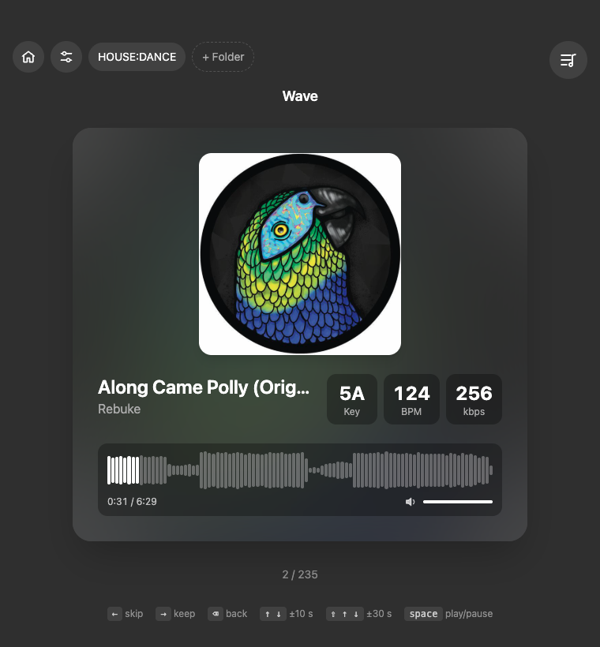
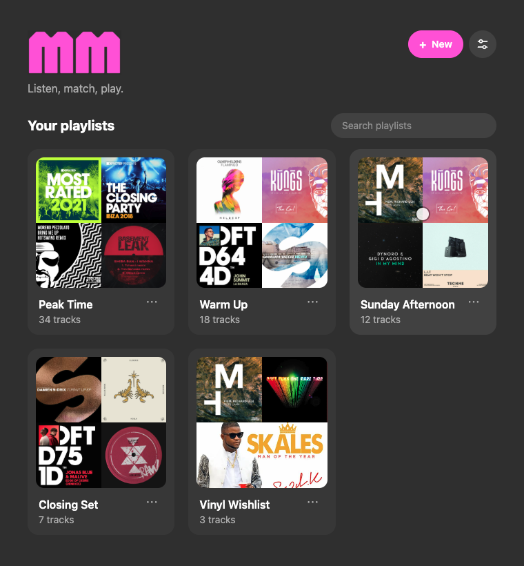
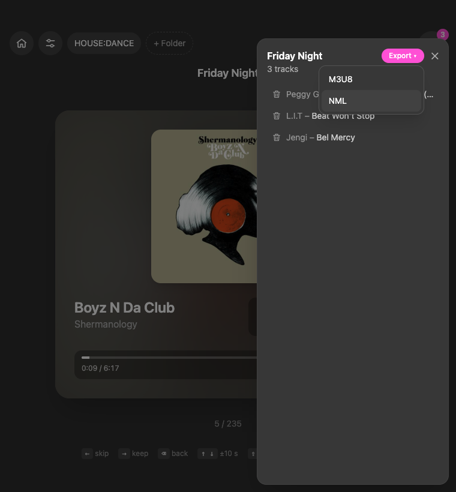

<p align="center">
  
</p>

<p align="center"><strong>Listen, match, play.</strong><br>Tinder for tracks: swipe through a folder of music, keep the good ones, export a playlist for Traktor.</p>

<p align="center">
  
</p>

## Why

A DJ ends up with hundreds of new tracks: promos, Beatport, Bandcamp. Going through them in a regular player is slow, you lose track of what you've heard, and the playlist has to be rebuilt by hand. MMatch shows one track at a time and asks one question: **keep** or **skip**.

## Features

**Matching**
- One track at a time, full screen, playing as soon as it appears
- `→` keep, `←` skip, or drag the card like on Tinder
- `⌫` goes back to the previous track
- `↑` `↓` seek ±10 s, `⇧` + `↑` `↓` ±30 s: straight to the drop
- `space` play / pause
- SoundCloud-style waveform: see intro, breakdown and drop, click to jump there

**DJ info**
- Key and BPM from the file tags
- Missing tags? Key and BPM are computed in the background with [essentia.js](https://mtg.github.io/essentia.js/), using a profile tuned for electronic music
- Camelot (`5A`) or musical (`Am`) key notation
- Configurable BPM range, so a halved or doubled tempo gets folded back
- Bitrate (kbps) to spot low-quality files

**Playlists and folders**
- Named playlists, each with its own keep list
- Resume where you left off: tracks already seen are never shown again
- Home with mosaic covers, search, clone, rename, delete
- Pull tracks from several folders (subfolders included), hide one for a while
- Unplugged drive? MMatch asks where the folder is now, without losing your progress

**Export**
- **NML** for Traktor
- **M3U8** for Rekordbox, Serato, VLC and most other players

**Everything stays local**: no account, no cloud, no upload. Audio files are never moved or modified. English and Italian UI.

<p align="center">
  
  
</p>

## Supported formats

MP3, WAV, FLAC, M4A/AAC, OGG. AIFF files are listed but can't be played (Chromium doesn't decode them).

## Install

Download the `.dmg` from [Releases](../../releases). The app isn't notarized by Apple, so on first launch macOS says it's from an unidentified developer: right-click the app → **Open**.

If macOS says the app is "damaged", remove the quarantine flag:

```bash
xattr -cr /Applications/MMatch.app
```

Built and tested on macOS (Apple Silicon). Windows and Linux builds are configured but untested.

## Development

Electron + React + TypeScript, built with [electron-vite](https://electron-vite.org), styled with Tailwind CSS v4.

```bash
yarn            # install
yarn dev        # run with hot reload
yarn test       # export tests (M3U8, NML)
yarn typecheck
yarn build:mac  # .dmg in dist/
```

Playlists live in `playlists.json` inside the app data folder (`~/Library/Application Support/mmatch` on macOS), so they survive app updates.
